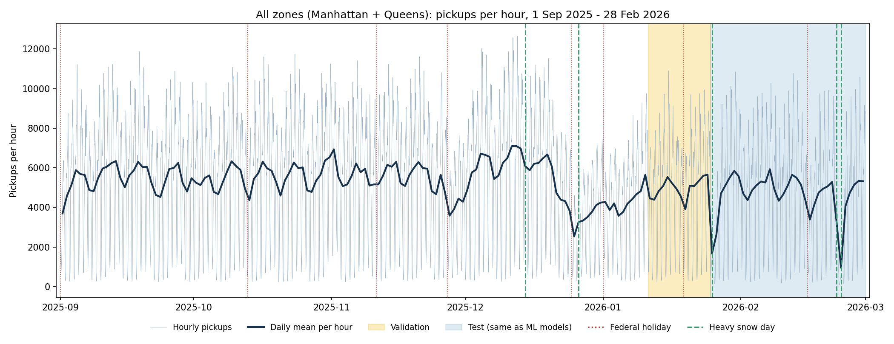
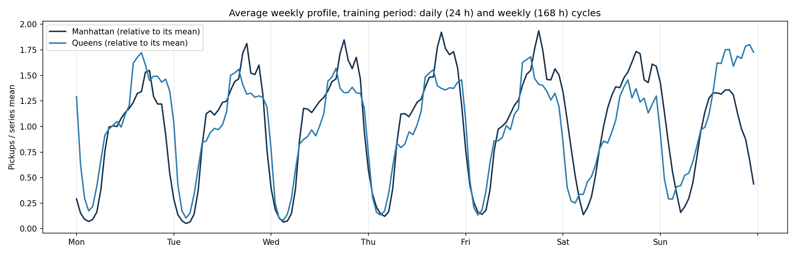
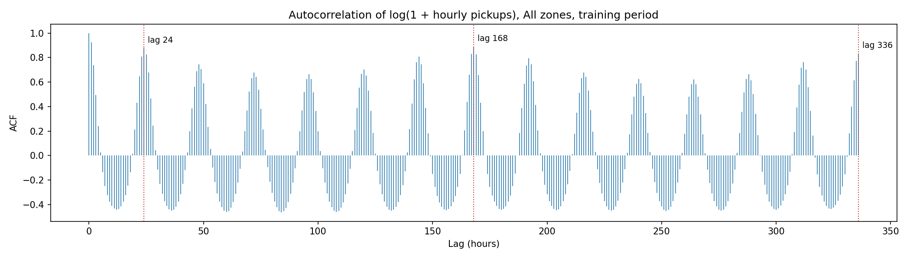

# Time Series Data Preparation

This document covers the data preparation for the time series analysis stage (Review 2). It explains why a separate time series dataset was built, every step and decision, every output file and field, the checks that were run, and what the readiness diagnostics suggest for the analysis.

- Code: [`scripts/time_series_data_preparation.ipynb`](../../scripts/time_series_data_preparation.ipynb). Run all cells, about 3 minutes.
- Outputs: [`data/processed/time_series/`](../processed/time_series/)
- Related: [data_collection.md](data_collection.md) (how the raw data was collected), [data_processing.md](data_processing.md) (cleaning and the ML feature table), [EDA findings](../../EDA_doc/EDA_findings.md)

## 1. Purpose

The next stage forecasts and analyses taxi demand as **time series**: decomposition, stationarity and autocorrelation analysis, and models such as seasonal ARIMA, dynamic harmonic regression, exponential smoothing and Prophet. Those methods have stricter requirements than the machine-learning models:

1. **An unbroken, regular time index.** Every hour present exactly once, no gaps, no repeats.
2. **The full history.** Every hour of data available for fitting.
3. **Series at the right level.** City and borough series are smooth and easy to model. Individual zones range from very busy to almost empty.
4. **Known-in-advance regressors.** Calendar, holidays, events and seasonal terms that are available at forecast time.
5. **A time-based evaluation design.** Fixed train/validation/test periods and rolling-origin folds.

The ML feature table `data/processed/features.csv` was built for the regression models and does not meet these needs:

| Requirement | `features.csv` | Time series dataset |
|---|---|---|
| Full history | Starts 8 Sep: the first week was dropped as warm-up for the 168 h lag | Starts 1 Sep, all 4,344 hours. Time series models don't need a warm-up week dropped |
| Levels | Zone-hour only | City, borough, service area and zone; hourly and daily |
| Daylight-saving double hour | Described in docs only | Flagged, plus an adjusted target and flags for the affected lags |
| Calendar effects | One `is_holiday` flag | Holiday names, holiday periods, days to/from holidays, special days, cross-midnight night events, weekend nights, heavy-snow days |
| Seasonality | Raw `hour`, `day_of_week` | Daily and weekly Fourier terms, `hour_of_week`, time bands, trend index |
| Taxi type | Combined | Yellow and green kept as separate columns |
| Evaluation design | Split later in the modelling notebook | Train/validation/test built in, with the **same test period as the ML models**, plus 6 rolling-origin folds |
| Per-zone behaviour | None | Volume tier and demand pattern per zone, computed on training data only |

The time series dataset is not a replacement for `features.csv`. Both describe **exactly the same demand**: the rebuilt counts match `features.csv` on all 576,288 zone-hours they share (section 6).

## 2. Inputs

| File | Used for |
|---|---|
| `data/raw/NYC-taxi-demand-Manhattan-Queens.csv` | Trip records (3.2 GB, from the private Kaggle dataset) |
| `data/raw/weather_hourly_by_zone.csv` | The 138 × 4,344 hour grid, zone weather and weather grid cells |
| `data/raw/taxi_zones_manhattan_queens.csv` | Borough, service area and coordinates of each zone |
| `data/processed/cleaning_report.md` | Cross-check: removals per cleaning rule |
| `data/processed/features.csv` | Cross-check: counts and holiday flag |
| `models/modeling/split_summary.csv` | The ML models' test period, reused so results can be compared |

## 3. Preparation steps

```
raw trips (23,318,979)
   │  Step 1  same 4 cleaning rules as the processing stage  → 22,579,793 clean trips
   ▼
zone-hour counts (yellow, green)
   │  Step 2  full 138 × 4,344 grid, zero-fill, DST adjustment, zone weather
   ▼
zone hourly panel (599,472 rows) ──────────────┐
   │  Step 3  calendar, events, Fourier terms,   │  Step 5  zone daily series,
   │          DST flags, splits, CV folds        │          zone profiles (train only)
   ▼                                             ▼
   Step 4  aggregate series: city, borough, service area (hourly + daily)
   ▼
   Step 6  readiness checks and diagnostics → data/processed/time_series/
```

### Step 1: Clean the trips

The series are rebuilt from the raw trips because `features.csv` lacks the first week and the yellow/green split. To describe the same demand as the rest of the project, the **same four rules** as `scripts/data_processing_engineering.ipynb` are applied in the same order:

| Rule | Removed |
|---|---:|
| 1. Exact duplicate rows | 276,749 |
| 2. Dropoff at or before pickup | 329,654 |
| 3. Trip longer than 6 hours | 6,826 |
| 4. Dropoff zone 264 or 265 (unknown or outside NYC) | 125,957 |
| **Clean trips** | **22,579,793** |

The notebook reads the expected numbers from `cleaning_report.md` and stops if any differs. All four match exactly.

### Step 2: Zone-hour panel

- Each trip is assigned to the hour it started in (07:42 → 07:00), and trips are counted per zone and hour, separately for yellow and green.
- The full grid of **138 zones × 4,344 hours = 599,472 rows** comes from the weather table. Hours with no pickups get **0**: they are real observations of zero demand, and a time series can't have holes.
- The zone's own hourly weather is attached (apparent temperature, rain, snowfall, precipitation probability).

**Daylight saving time.** TLC timestamps are local wall-clock times with no offset. On 2 Nov 2025 the clocks went back at 02:00, so 01:00-01:59 happened twice, and both physical hours are recorded under one `01:00` label. Two options were considered:

- **Switch to UTC.** This would give 4,345 physical hours, but the trips in the merged label can't be split between the two physical hours, so the extra hour could only be filled with a guess.
- **Keep local wall-clock time and adjust that one value (chosen).** The index stays perfectly regular (4,344 consecutive labels), "hour of day" keeps its everyday meaning, and the dataset carries:
  - `trip_count`: the observed count, unchanged
  - `trip_count_adj`: the same, except the merged hour is divided by 2, the number of physical hours it covers, so every value means **pickups per physical hour**
  - flags for the merged hour and for the hours whose 24 h and 168 h lags read it (step 3)

City-wide, the merged hour has 9,166 trips against 8,735 at 00:00 and 3,423 at 02:00. The adjusted value of 4,583 fits smoothly between them. **Fit models on `trip_count_adj`.** The test period has no DST hour, so `trip_count_adj` and `trip_count` are identical there, and evaluation is unaffected.

### Step 3: Calendar and event table

One row per hour holds every time-related regressor (`ts_calendar_hourly.csv`). Everything except `is_heavy_snow_day` is **known in advance** (calendar, published holidays, scheduled events), so it can be used when forecasting without leakage. The event definitions are the same ones the EDA used (`scripts/eda_arun.py`), so both stages talk about the same events.

- **Trend and position.** `t` (hours since start), `day_index`, `week_index` (1 Sep 2025 is a Monday, so weeks run Monday to Sunday), `hour_of_week` (0-167).
- **Calendar.** Hour, weekday, weekend, month, day of month, ISO week, and the EDA's six time bands.
- **Weekend nights.** Friday and Saturday 20:00-04:59. The hours after midnight belong to the evening before, as in the EDA.
- **Federal holidays with names.** The EDA found holidays differ a lot: Christmas −58%, Thanksgiving −45%, Columbus Day −8% and MLK Day about 0%, each against comparable normal days. One shared flag can't capture that. All 8 holidays in the window are kept, including Labor Day, which `features.csv` lost with its warm-up week. Days to the next and since the previous holiday are counted across holidays outside the window too (4 July 2025, Memorial Day 2026), so the edge values are correct.
- **Holiday periods.** Thanksgiving week (24-30 Nov) and Christmas-New Year (20 Dec - 4 Jan). The EDA measured −24% and −27%.
- **Special days.** Halloween, NYC Marathon (2 Nov, also the DST day), Black Friday, Christmas Eve, New Year's Eve.
- **Night events.** Halloween night and New Year's Eve night, 20:00-04:59 across midnight. A calendar-day flag would cut these in two. The EDA measured +62% for New Year's Eve night.
- **DST flags.** The merged hour, plus the two hours whose 24 h and 168 h lags point at it.
- **Heavy-snow days.** The median zone snowfall for the day is at least 5 cm, the EDA's rule. Five days qualify: 14 Dec, 26 Dec, **25 Jan** (about 19 cm, the biggest storm in the data), **22 Feb** and **23 Feb**. This flag is derived from the weather data, so at forecast time it is only known through a weather forecast.
- **Fourier terms.** $\sin(2\pi k h/P)$ and $\cos(2\pi k h/P)$ for the daily cycle ($P = 24$) and the weekly cycle ($P = 168$), with $k = 1, 2, 3$: 12 columns. These are the standard way to give ARIMA (dynamic harmonic regression), regression and Prophet-style models a long seasonal period. A seasonal ARIMA with a 168-hour season is impractical to fit. They also work as cyclical encodings, so 23:00 sits next to 00:00. With only six months of data there is no yearly seasonality to model.
- **Splits.** See section 5.

### Step 4: Aggregate series

Six series at three levels are built by summing the zone panel:

| Level | `series_id` | Zones | Clean trips | Mean pickups/hour | Max |
|---|---|---:|---:|---:|---:|
| city | All zones | 138 | 22,579,793 | 5,196.9 | 12,648 |
| borough | Manhattan | 69 | 20,431,943 | 4,702.5 | 11,843 |
| borough | Queens | 69 | 2,147,850 | 494.4 | 1,449 |
| service_area | Yellow Zone | 55 | 19,472,673 | 4,481.7 | 11,277 |
| service_area | Boro Zone | 81 | 1,639,075 | 377.3 | 1,172 |
| service_area | Airports | 2 | 1,468,045 | 337.9 | 1,058 |

Each series and hour has the observed and adjusted counts, yellow and green, $\log(1+y)$ of the adjusted count, the number of zones and of zones with at least one pickup, the **mean weather across its zones**, and all calendar columns.

- **Why a plain mean for weather.** Weighting by each zone's pickups in that hour would put the target inside a regressor.
- **Why $\log(1+y)$.** The EDA found demand strongly right-skewed and overdispersed. A log evens out the variance (ARIMA and ETS assume roughly constant variance), and $\log(1+y)$ keeps zero hours valid. Forecasts made on the log scale need back-transforming with $e^{\hat{y}}-1$, which estimates the median rather than the mean. Check this on the validation period.

Daily versions of the six series have daily weather summaries (temperature mean/min/max, rain and snow totals, precipitation probability mean/max, hours with rain or snow), the day-level calendar fields and 7-day Fourier terms.

### Step 5: Zone-level series and zone profiles

- **Zone hourly panel.** 599,472 rows, kept narrow (counts plus the zone's own weather). Calendar fields are the same for every zone, so they stay in the calendar table and are joined on `ds`. This keeps the file at about 31 MB, within GitHub's limits.
- **Zone daily series.** 138 zones × 181 days.
- **Zone profiles.** The 138 series behave very differently, so each zone gets a profile. **It uses the training period only**, so the test period can't influence any modelling choice:
  - **Volume tier** by mean pickups per hour: High ≥ 50, Medium 10-50, Low 1-10, Sparse > 0 and < 1, Zero.
  - **Demand pattern** (Syntetos-Boylan classification):
    - **ADI** = hours ÷ hours with at least one pickup
    - **CV²** = squared coefficient of variation of the non-zero counts
    - *smooth*: ADI < 1.32 and CV² < 0.49
    - *erratic*: ADI < 1.32 and CV² ≥ 0.49
    - *intermittent*: ADI ≥ 1.32 and CV² < 0.49
    - *lumpy*: ADI ≥ 1.32 and CV² ≥ 0.49
  - **Suggested approach** derived from the pattern.
  - **Weather cell.** The 138 zones get their weather from 50 Open-Meteo grid cells, so zones in one cell are not independent weather observations.

| Volume tier | smooth | erratic | intermittent | lumpy | no demand | Total |
|---|---:|---:|---:|---:|---:|---:|
| High | 20 | 19 | 0 | 0 | 0 | 39 |
| Medium | 17 | 7 | 0 | 0 | 0 | 24 |
| Low | 11 | 9 | 5 | 9 | 0 | 34 |
| Sparse | 0 | 0 | 38 | 1 | 0 | 39 |
| Zero | 0 | 0 | 0 | 0 | 2 | 2 |

Result: **83 zones** can be modelled as individual series, **53** need an intermittent-demand method (Croston/TSB) or pooling into their borough or service-area series, and **2** (zones 103 and 104, the Governor's/Ellis/Liberty Island zones) have no demand and only appear at aggregate level.

For hourly data, a high CV² in busy zones mostly reflects the strong daily cycle, not randomness. For those zones "erratic" means "needs seasonal terms". The pattern matters most for its ADI part, which separates regular demand from intermittent demand.

## 4. Why no lag features in this dataset?

`features.csv` already has lag and rolling features for the ML models. Time series models build their own dependence on the past: ARIMA through its AR/MA terms and differencing, ETS through its smoothing states. Fixed lag columns would duplicate that, and dropping the warm-up rows they need would break the continuous history. Anyone who needs lags for a regression-style forecaster can compute them from the regular series with `groupby(...).shift(k)`. The `is_dst_lag24_affected` and `is_dst_lag168_affected` flags show where such lags read the DST hour.

## 5. Evaluation design

| Split | Hourly period | Hours | Daily period | Days |
|---|---|---:|---|---:|
| train | 2025-09-01 00:00 - 2026-01-11 03:00 | 3,172 | 2025-09-01 - 2026-01-10 | 132 |
| validation | 2026-01-11 04:00 - 2026-01-25 03:00 | 336 | 2026-01-11 - 2026-01-24 | 14 |
| **test** | **2026-01-25 04:00 - 2026-02-28 23:00** | **836** | 2026-01-25 - 2026-02-28 | 35 |

- **Test** is read from `models/modeling/split_summary.csv`. It is exactly the window the naive 168 h baseline, Linear Regression, Random Forest and HistGradientBoosting were scored on. At zone level, the test rows of `ts_zone_hourly.csv` are the same 138 × 836 = 115,368 zone-hours as the ML test set, so MAE, RMSE and R² can be compared directly.
- **Validation** is the two weeks just before test, for choosing orders and settings without touching test.
- **Train** starts on 1 Sep. The ML training set started on 8 Sep, but time series models have no lag warm-up to drop.
- **Rolling-origin folds** (`ts_cv_folds.csv`): six folds that each forecast 7 days (168 hours), with weekly cut-offs from 14 Dec to 24 Jan. Each fold trains on everything before its window. Use them to check that a model's accuracy holds up across several weeks, including the holiday period, rather than on one window.

**Watch out:** the test period starts with the biggest snowstorm in the data (25 Jan) and contains two more heavy-snow days (22-23 Feb). Demand on those days drops far below normal (see figure 1). Report test errors for the whole period and also without those days, so a single storm doesn't dominate the comparison.

## 6. Checks

Every check is recorded in [`ts_readiness_checks.csv`](../processed/time_series/ts_readiness_checks.csv). **All 30 passed.** The main ones:

| Check | Result |
|---|---|
| Cleaning matches `cleaning_report.md` | All four rule counts identical |
| Counts match `features.csv` | 576,288 zone-hours compared, **0 mismatches** |
| Holiday flag matches `features.csv` | 4,176 hours compared, identical |
| Complete, regular grid | 138 × 4,344 rows; every step within a zone is exactly 1 hour |
| Every clean trip counted once | 22,579,793 in the zone panel, in every level's total, and in the daily totals |
| Yellow + green = total | True in all four count tables |
| No missing values | In all five data tables |
| Zone weather equals the source table | 599,472 rows identical |
| Test period equals the ML models' | 836 hours, 25 Jan 04:00 - 28 Feb 23:00 |
| Zone profiles use training data only | Last hour used: 2026-01-11 03:00 |

## 7. Readiness diagnostics and starting points for the analysis

These diagnostics use the training period only.

**Stationarity** (`ts_stationarity_tests.csv`). ADF (null: non-stationary) and KPSS (null: stationary) were run on the `All zones` log series:

| Series | Transformation | ADF p | KPSS p | Stationary by both |
|---|---|---:|---:|---|
| hourly | log level | 0.000 | 0.018 | No |
| hourly | seasonal difference, 168 h | 0.001 | ≥ 0.10 | **Yes** |
| hourly | seasonal 168 h + first difference | 0.000 | ≥ 0.10 | Yes |
| daily | log level | 0.016 | 0.081 | Yes (borderline) |
| daily | seasonal difference, 7 days | 0.004 | ≥ 0.10 | **Yes** |
| daily | seasonal 7 days + first difference | 0.000 | ≥ 0.10 | Yes |

**Seasonal periods** (`ts_acf_key_lags.csv`). The autocorrelation of the hourly log series is 0.93 at lag 1, 0.88 at lag 24 and **0.89 at lag 168**, the highest of the seasonal lags. It stays at 0.83 at lag 336 (figure 3). The weekly cycle is the main one, with the daily cycle inside it (figure 2).

**Suggested starting points:**
- **Hourly:** one seasonal difference at 168 hours (D = 1) is enough, and an extra first difference is not needed (d = 0). A seasonal ARIMA with a 168-hour season is impractical, so these work better:
  - ARIMA errors with the daily and weekly Fourier terms plus calendar and event dummies (dynamic harmonic regression)
  - MSTL decomposition with periods 24 and 168
  - TBATS or Prophet, with the holiday and event columns as regressors
- **Daily:** seasonal ARIMA with a weekly season (m = 7, D = 1) or ETS with weekly seasonality, with holiday and snow dummies.
- **Baseline:** the seasonal naive forecast (same hour last week) is the natural baseline, and it is the ML stage's 168-hour baseline (test MAE 9.31). Compare against it on the same test rows.
- **Zones:** model the 83 regular zones individually. Use Croston/TSB for intermittent zones, or forecast them through their aggregate series.

These are starting points from the diagnostics, not results. Order selection and model comparison belong to the analysis stage.

**Weather as a regressor.** The weather columns are the observed weather for the hour (from the Open-Meteo historical forecast archive). Using them to forecast assumes the weather is known in advance, the "perfect forecast" case. In the ML stage, removing weather barely changed HistGradientBoosting's test error (`models/modeling/weather_ablation_results.csv`). Test weather as an optional regressor and report both versions.

## 8. Figures

**Figure 1.** City-wide hourly pickups, daily mean, validation and test periods, holidays and heavy-snow days. The Christmas-New Year dip and the storm days in the test period stand out.



**Figure 2.** Average weekly profile per borough (training period). Five weekday cycles with an evening peak, different weekend shapes, and Queens highest on Sunday evening, probably because of the two airports, which are in Queens.



**Figure 3.** Autocorrelation of the hourly log series up to two weeks. Peaks every 24 hours, highest at 168 and 336.



## 9. Output files and fields

All files are in `data/processed/time_series/`, as CSV, with timestamps as `YYYY-MM-DD HH:MM:SS` in naive local New York time. Booleans are `True`/`False`.

| File | Rows × columns | Size | Contents |
|---|---|---:|---|
| `ts_aggregate_hourly.csv` | 26,064 × 58 | 9.2 MB | 6 series × 4,344 hours, with all calendar fields |
| `ts_aggregate_daily.csv` | 1,086 × 45 | 0.3 MB | 6 series × 181 days |
| `ts_zone_hourly.csv` | 599,472 × 10 | 30.7 MB | 138 zones × 4,344 hours (join the calendar on `ds`) |
| `ts_zone_daily.csv` | 24,978 × 16 | 2.1 MB | 138 zones × 181 days |
| `ts_calendar_hourly.csv` | 4,344 × 45 | 1.2 MB | Calendar, events, Fourier terms, DST flags, splits |
| `ts_zone_profile.csv` | 138 × 20 | < 0.1 MB | Zone profiles (training period) |
| `ts_cv_folds.csv` | 6 × 7 | < 0.1 MB | Rolling-origin folds |
| `ts_stationarity_tests.csv` | 6 × 6 | < 0.1 MB | ADF/KPSS results |
| `ts_acf_key_lags.csv` | 11 × 2 | < 0.1 MB | Autocorrelation at key lags |
| `ts_readiness_checks.csv` | 30 × 3 | < 0.1 MB | Every check and its result |

### 9.1 Count and weather fields (aggregate, zone and daily tables)

| Field | Type | Description | Purpose |
|---|---|---|---|
| `series_level` | text | `city`, `borough` or `service_area` (aggregate tables) | Pick a level |
| `series_id` | text | `All zones`, `Manhattan`, `Queens`, `Yellow Zone`, `Boro Zone`, `Airports` | Identifies one series |
| `PULocationID` | int | TLC pickup zone (zone tables) | Identifies one zone series |
| `ds` | datetime | Start of the hour, local time (hourly tables) | Time index, the usual name in forecasting libraries |
| `date` | date | Calendar day (daily tables, calendar) | Daily time index |
| `trip_count` | int | Clean pickups in the hour or day | Observed demand |
| `trip_count_adj` | float | `trip_count` with the DST merged hour halved | **Target for fitting**: pickups per physical hour |
| `trip_count_yellow`, `trip_count_green` | int | Pickups by taxi type, adding up to `trip_count` | Fleet-level analysis; green is about 1% overall but 12% in Boro Zones |
| `log1p_trip_count_adj` | float | $\log(1 + \text{trip\_count\_adj})$ (aggregate tables) | Variance-stabilised target |
| `n_zones` | int | Zones in the series | Scale and normalising |
| `active_zones` | int | Zones with at least one pickup that hour (aggregate hourly) | How widespread demand is |
| `apparent_temperature` | float | Feels-like temperature at the start of the hour, °C (series: mean over zones) | Weather regressor |
| `rain` | float | Rain during the hour, mm (series: mean over zones) | Weather regressor |
| `snowfall` | float | Snowfall during the hour, cm (series: mean over zones) | Weather regressor |
| `precipitation_probability` | float/int | Chance of precipitation in the hour, % (series: mean over zones) | Weather regressor |
| `apparent_temperature_mean`, `_min`, `_max` | float | Daily mean, minimum and maximum of hourly apparent temperature, °C | Daily weather regressors |
| `rain_total`, `snowfall_total` | float | Daily rain (mm) and snow (cm) totals | Daily weather regressors |
| `precipitation_probability_mean`, `_max` | float | Daily mean and maximum precipitation probability, % | Daily weather regressors |
| `rain_hours`, `snow_hours` | int | Hours in the day with rain or snow above 0 | How long the bad weather lasted |
| `split` | text | `train`, `validation` or `test` | Evaluation design (section 5) |

### 9.2 Calendar and event fields (`ts_calendar_hourly.csv`; also in the aggregate tables)

| Field | Type | Description | Purpose |
|---|---|---|---|
| `t` | int | Hours since 1 Sep 2025 00:00 (0-4,343) | Trend term |
| `day_index`, `week_index` | int | Days and Monday-start weeks since 1 Sep 2025 | Trend and grouping |
| `hour`, `day_of_week`, `day_name` | int, int, text | Hour (0-23), weekday (0 = Monday), weekday name | Daily and weekly cycles |
| `is_weekend` | bool | Saturday or Sunday | Weekday vs weekend demand |
| `month`, `day_of_month`, `iso_week` | int | Calendar position | Level shifts, grouping |
| `hour_of_week` | int | `day_of_week × 24 + hour` (0-167) | Position in the weekly cycle; key for weekly profiles |
| `time_band` | text | EDA bands: Late night 00-04, Early morning 05-06, AM 07-09, Midday 10-15, PM 16-19, Evening 20-23 | Grouped time-of-day effects |
| `is_weekend_night` | bool | Friday or Saturday 20:00-04:59 | Nightlife demand (EDA I5) |
| `is_holiday`, `holiday_name` | bool, text | US federal holiday and its name | Holiday-specific effects (EDA E1) |
| `is_day_before_holiday`, `is_day_after_holiday` | bool | Day before or after a federal holiday | Lead and lag effects |
| `days_to_next_holiday`, `days_since_prev_holiday` | int | Days to the next and since the last federal holiday (0 on the holiday) | Distance-to-holiday effects |
| `holiday_period`, `is_holiday_period` | text, bool | Thanksgiving week or Christmas-New Year | Period effects (EDA E2) |
| `special_day_name`, `is_special_day` | text, bool | Halloween, NYC Marathon, Black Friday, Christmas Eve, New Year's Eve | Event effects (EDA E4) |
| `night_event_name`, `is_night_event` | text, bool | Halloween night, New Year's Eve night (20:00-04:59) | Cross-midnight events (EDA E3) |
| `is_dst_merged_hour` | bool | 2025-11-02 01:00, which holds two physical hours | Mark the DST artefact |
| `is_dst_lag24_affected`, `is_dst_lag168_affected` | bool | Hours whose 24 h and 168 h lags read the merged hour | Mark affected lags (EDA A8) |
| `is_heavy_snow_day` | bool | Zone-median daily snowfall ≥ 5 cm (derived from weather) | Storm effects |
| `fourier_daily_sin_k`, `fourier_daily_cos_k` | float | $\sin/\cos(2\pi k\,\text{hour}/24)$, k = 1-3 | Daily seasonality regressors |
| `fourier_weekly_sin_k`, `fourier_weekly_cos_k` | float | Hourly tables: $\sin/\cos(2\pi k\,\text{hour\_of\_week}/168)$. Daily tables: $\sin/\cos(2\pi k\,\text{day\_of\_week}/7)$. k = 1-3 | Weekly seasonality regressors |
| `split`, `split_daily` | text | Hourly split, and the split of the calendar day (daily tables have this as `split`) | Evaluation design |
| `contains_dst_merged_hour` | bool | 2 Nov 2025, whose `trip_count` includes the extra hour (daily tables) | Mark the DST day |

### 9.3 Zone profile fields (`ts_zone_profile.csv`)

| Field | Description |
|---|---|
| `PULocationID`, `Borough`, `Zone`, `service_zone`, `latitude`, `longitude` | Zone identity and centre point |
| `train_hours`, `train_total_trips` | Hours and pickups in the training period |
| `train_mean`, `train_median`, `train_std`, `train_p95`, `train_max` | Hourly demand statistics, training period |
| `train_zero_share` | Share of training hours with no pickups |
| `adi`, `cv2` | Average demand interval and squared coefficient of variation of non-zero demand |
| `volume_tier` | High, Medium, Low, Sparse or Zero |
| `demand_pattern` | smooth, erratic, intermittent, lumpy or no demand |
| `suggested_approach` | individual series model, intermittent-demand method or pool to aggregate, or aggregate level only |
| `weather_cell_id` | Open-Meteo grid cell supplying the zone's weather (50 cells) |

### 9.4 Fold fields (`ts_cv_folds.csv`)

`fold`, `train_start`, `train_end`, `forecast_start`, `forecast_end`, `forecast_hours` (168), `forecast_days` (7).

## 10. How to use it

```python
import pandas as pd

TS = "data/processed/time_series/"

# one city or borough series, hourly, with all regressors
agg = pd.read_csv(TS + "ts_aggregate_hourly.csv", parse_dates=["ds", "date"])
manhattan = agg[agg["series_id"] == "Manhattan"].set_index("ds").asfreq("h")
train = manhattan[manhattan["split"] == "train"]

# zone panel with the calendar joined
zone = pd.read_csv(TS + "ts_zone_hourly.csv", parse_dates=["ds"])
cal = pd.read_csv(TS + "ts_calendar_hourly.csv", parse_dates=["ds", "date"])
zone = zone.merge(cal, on="ds", how="left")

# zones that can be modelled individually
profile = pd.read_csv(TS + "ts_zone_profile.csv")
regular_zones = profile.loc[profile["suggested_approach"] == "individual series model", "PULocationID"]
```

`.asfreq("h")` works directly because the index has no gaps or repeats.

## 11. Things to know

- **Fit on `trip_count_adj`, evaluate on the test split.** There is no DST hour in the test period, so evaluation is unaffected.
- **The test period contains three heavy-snow days**, including the biggest storm in the data on its first day. Report errors with and without them.
- **Holidays are single events.** Each federal holiday appears once in the data, so holiday-specific effects can't be validated on another year. Treat them as dummies, not as learned patterns.
- **Six months of data.** Daily and weekly seasonality are well supported. Yearly seasonality and long-term trends can't be estimated.
- **Zone weather comes from 50 grid cells.** Zones sharing a cell have the same or very similar weather.
- **Observed pickups measure completed trips, not unmet demand.**
- **Reproduce:** get `NYC-taxi-demand-Manhattan-Queens.csv` from Kaggle into `data/raw/` (see [DATA_GUIDE.md](../DATA_GUIDE.md)), install `requirements.txt`, and run the notebook. All outputs are overwritten and every check is re-run.
